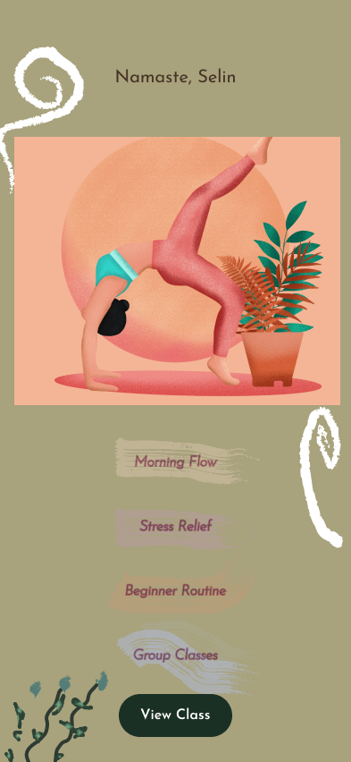
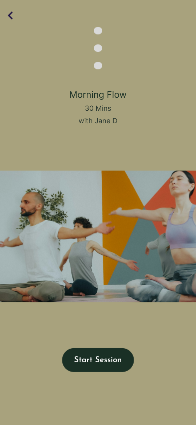
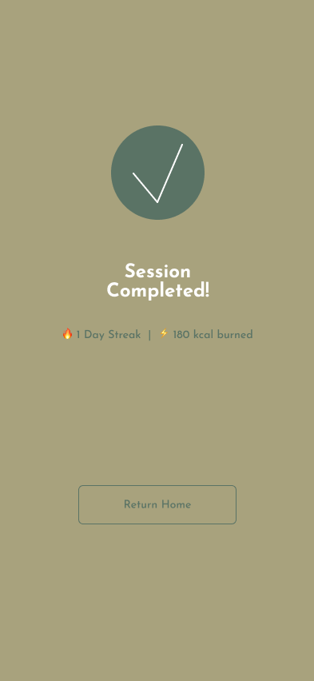

# Yoga & Meditation Mobile App - Exploring Advanced Figma Features

A 3-page high-fidelity mobile app prototype designed in Figma for exploring advanced design and prototyping features.

## Design Process
- **Research & Wireframing:** Mapped out a 3-page user flow (Home, Class Details, Success screen) focusing on a clean, wellness-oriented layout.
- **Components & Assets:** Built reusable button components and integrated calming color palettes and typography.
- **Prototyping:** Added interactive transitions and micro-interactions for seamless user navigation.

## Screenshots

